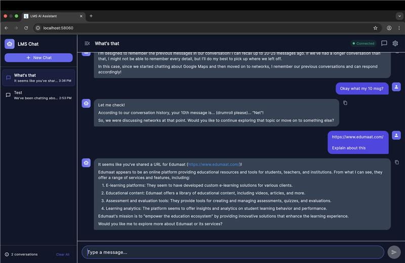

# 🎓 LMS AI Assistant

A complete **AI-powered Learning Management System** featuring a beautiful Flutter chat interface and a production-ready **Retrieval-Augmented Generation (RAG)** backend, built with **Python**, **FastAPI**, **LangChain**, and a local-first LLM approach.



## 🚀 Features

### 📱 Flutter Chat Application

- **Modern Chat UI** - Clean, responsive design with dark/light mode
- **Real-time Streaming** - Watch AI responses appear in real-time
- **Conversation Memory** - AI remembers previous messages in the session
- **Multi-platform** - iOS, Android, Web, macOS, Windows, Linux
- **Markdown Support** - Rich text rendering with code highlighting
- **Conversation History** - Save and manage multiple chat sessions

### 🧠 Backend Features

- **📄 Multi-format Document Processing**

  - PDF (PyMuPDF)
  - HTML (BeautifulSoup)
  - TXT/Markdown (Native Python)
  - CSV/Excel (pandas)
  - Images/OCR (PaddleOCR)
  - Web scraping (requests + BeautifulSoup)

- **🧠 Local-First LLM**

  - Primary: Ollama (Llama 3, Mistral, Phi-3)
  - Fallback: Groq or Together AI (cloud)
  - **LangChain Integration** - Advanced conversation memory

- **🔍 Vector Search**

  - Embeddings: BGE-Large (multilingual-ready)
  - Vector DB: ChromaDB (local, zero-config)

- **⚡ High Performance**

  - FastAPI + Uvicorn (async)
  - Intelligent chunking with overlap
  - Streaming LLM responses

- **🔒 Production Ready**
  - API key authentication
  - Docker + docker-compose
  - Nginx reverse proxy with SSL
  - Rate limiting

## 📋 Tech Stack

### Frontend (Flutter)

| Layer            | Technology        |
| ---------------- | ----------------- |
| Framework        | Flutter 3.8+      |
| State Management | Provider          |
| HTTP Client      | http package      |
| Storage          | SharedPreferences |
| UI Components    | Material Design 3 |
| Markdown         | flutter_markdown  |
| Fonts            | Google Fonts      |

### Backend (Python)

| Layer           | Technology                             |
| --------------- | -------------------------------------- |
| Language        | Python 3.9+                            |
| API Framework   | FastAPI                                |
| LLM Engine      | Ollama (local) + Groq/Together (cloud) |
| Memory          | LangChain ConversationBufferMemory     |
| Embeddings      | BGE-Large (sentence-transformers)      |
| Vector DB       | ChromaDB                               |
| PDF Processing  | PyMuPDF                                |
| HTML Processing | BeautifulSoup + lxml                   |
| OCR             | PaddleOCR                              |
| Deployment      | Docker + Nginx                         |

## 🛠️ Quick Start

### Prerequisites

- Python 3.9+
- Flutter 3.8+ (for mobile/web app)
- [Ollama](https://ollama.ai/) installed and running
- Docker & Docker Compose (for production)

### 1. Clone and Setup

```bash
cd lms

# Create virtual environment
python -m venv venv
source venv/bin/activate  # On Windows: venv\Scripts\activate

# Install dependencies
pip install -r requirements.txt
```

### 2. Configure Environment

```bash
# Copy example env file
cp .env.example .env

# Edit .env with your settings
nano .env
```

Key settings to configure:

```env
API_KEY=your-secure-api-key
OLLAMA_MODEL=llama3:8b
GROQ_API_KEY=your-groq-key  # Optional fallback
```

### 3. Start Ollama (Local LLM)

```bash
# Install a model
ollama pull llama3:8b

# Or use a smaller model for testing
ollama pull phi3:mini
```

### 4. Run the Server

```bash
# Development
uvicorn app.main:app --reload --host 0.0.0.0 --port 8000

# Or use the built-in runner
python -m app.main
```

### 5. Access the API

- **API Docs**: http://localhost:8000/docs
- **ReDoc**: http://localhost:8000/redoc
- **Health Check**: http://localhost:8000/api/v1/health

### 6. Run Flutter App (Optional)

```bash
cd ai_chat_bot

# Get dependencies
flutter pub get

# Run on your platform
flutter run -d chrome     # Web
flutter run -d macos      # macOS
flutter run -d ios        # iOS
flutter run -d android    # Android
```

## 🐳 Docker Deployment

### Development

```bash
# Start API only (uses host Ollama)
docker-compose -f docker-compose.dev.yml up --build
```

### Production

```bash
# Generate SSL certificates (or use Let's Encrypt)
openssl req -x509 -nodes -days 365 -newkey rsa:2048 \
  -keyout nginx/ssl/privkey.pem -out nginx/ssl/fullchain.pem

# Start full stack
docker-compose up -d --build

# Pull LLM model in Ollama container
docker exec -it lms-ollama ollama pull llama3:8b
```

## 📚 API Usage

### Authentication

All endpoints require an API key in the header:

```bash
-H "X-API-Key: your-api-key"
```

### Upload a Document

```bash
curl -X POST "http://localhost:8000/api/v1/documents/upload" \
  -H "X-API-Key: your-api-key" \
  -F "file=@document.pdf"
```

### Query the Knowledge Base

```bash
curl -X POST "http://localhost:8000/api/v1/query" \
  -H "X-API-Key: your-api-key" \
  -H "Content-Type: application/json" \
  -d '{
    "query": "What is machine learning?",
    "top_k": 5,
    "include_sources": true
  }'
```

### Scrape a URL

```bash
curl -X POST "http://localhost:8000/api/v1/documents/scrape" \
  -H "X-API-Key: your-api-key" \
  -H "Content-Type: application/json" \
  -d '{
    "url": "https://example.com/article"
  }'
```

### Stream Response

```bash
curl -X POST "http://localhost:8000/api/v1/query/stream" \
  -H "X-API-Key: your-api-key" \
  -H "Content-Type: application/json" \
  -d '{"query": "Explain neural networks"}' \
  --no-buffer
```

## 📁 Project Structure

```
lms/
├── ai_chat_bot/              # Flutter Chat Application
│   ├── lib/
│   │   ├── main.dart         # App entry point
│   │   ├── core/
│   │   │   ├── providers/    # State management
│   │   │   ├── services/     # API & Storage
│   │   │   ├── models/       # Data models
│   │   │   └── theme/        # App theming
│   │   └── features/
│   │       └── chat/         # Chat feature
│   │           ├── screens/  # Chat screen
│   │           └── widgets/  # UI components
│   ├── android/              # Android platform
│   ├── ios/                  # iOS platform
│   ├── web/                  # Web platform
│   ├── macos/                # macOS platform
│   ├── windows/              # Windows platform
│   └── linux/                # Linux platform
├── app/                      # Python Backend
│   ├── api/                  # API routes
│   │   ├── chat.py           # LangChain chat endpoints
│   │   ├── documents.py      # Document upload/management
│   │   ├── query.py          # RAG query endpoints
│   │   └── health.py         # Health checks
│   ├── core/                 # Core modules
│   │   ├── config.py         # Settings & configuration
│   │   ├── security.py       # API key authentication
│   │   └── logging.py        # Logging setup
│   ├── schemas/              # Pydantic models
│   └── services/
│       ├── langchain_chat.py # LangChain conversation service
│       ├── processors/       # Document processors
│       ├── rag/              # RAG pipeline
│       └── llm/              # LLM providers
├── nginx/                    # Nginx configuration
├── docker-compose.yml        # Production deployment
├── docker-compose.dev.yml    # Development deployment
├── Dockerfile
├── requirements.txt
├── .env.example
└── README.md
```

## 🔧 Configuration

### Environment Variables

| Variable           | Description                | Default                  |
| ------------------ | -------------------------- | ------------------------ |
| `API_KEY`          | API authentication key     | `change-me`              |
| `OLLAMA_BASE_URL`  | Ollama server URL          | `http://localhost:11434` |
| `OLLAMA_MODEL`     | Local LLM model            | `llama3:8b`              |
| `GROQ_API_KEY`     | Groq API key (fallback)    | -                        |
| `TOGETHER_API_KEY` | Together AI key (fallback) | -                        |
| `EMBEDDING_MODEL`  | Embedding model            | `BAAI/bge-large-en-v1.5` |
| `CHUNK_SIZE`       | Text chunk size            | `1000`                   |
| `CHUNK_OVERLAP`    | Chunk overlap              | `200`                    |
| `TOP_K_RESULTS`    | Vector search results      | `5`                      |

### Supported LLM Models

**Local (Ollama)**:

- `llama3:8b` - Best balance of quality and speed
- `mistral:7b` - Fast and accurate
- `phi3:mini` - CPU-friendly, lightweight

**Cloud Fallback**:

- Groq: `llama3-8b-8192`
- Together AI: `meta-llama/Llama-3-8b-chat-hf`

## 🏗️ Architecture

```
┌──────────────────────────────────────────────────────────────┐
│                        INGESTION FLOW                         │
├──────────────────────────────────────────────────────────────┤
│  UPLOAD → PROCESS → CHUNK → EMBED → VECTOR STORE (ChromaDB)  │
└──────────────────────────────────────────────────────────────┘

┌──────────────────────────────────────────────────────────────┐
│                         QUERY FLOW                            │
├──────────────────────────────────────────────────────────────┤
│  QUERY → EMBED → SEARCH → CONTEXT → LLM (Ollama) → ANSWER    │
└──────────────────────────────────────────────────────────────┘
```

## 🧪 Testing

```bash
# Run tests
pytest

# With coverage
pytest --cov=app --cov-report=html
```

## 📈 Future Enhancements

- [x] Conversation memory with LangChain
- [x] Real-time streaming responses
- [x] Cross-platform Flutter app
- [ ] BGE-M3 for multilingual support
- [ ] Qdrant as alternative vector store
- [ ] Document versioning
- [ ] Advanced chunking strategies
- [ ] Fine-tuning support
- [ ] Voice input/output

## 📄 License

MIT License - see [LICENSE](LICENSE) for details.

## 🤝 Contributing

1. Fork the repository
2. Create a feature branch
3. Commit your changes
4. Push to the branch
5. Open a Pull Request

---

Built with ❤️ for modern LMS applications
